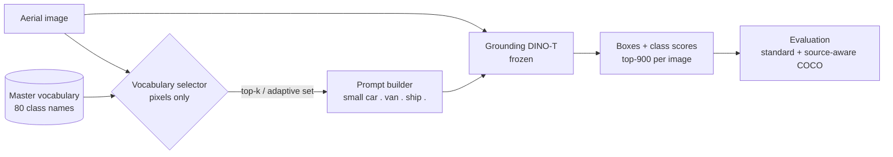
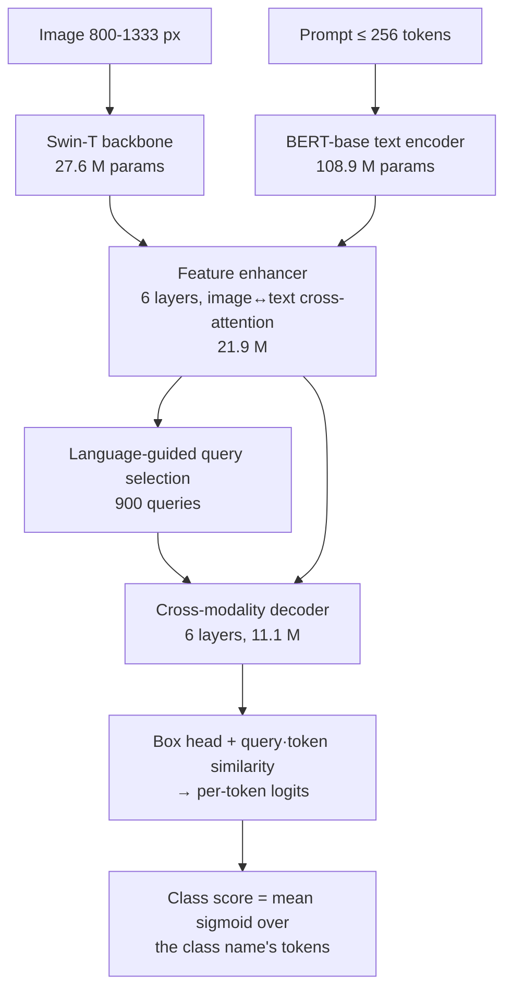
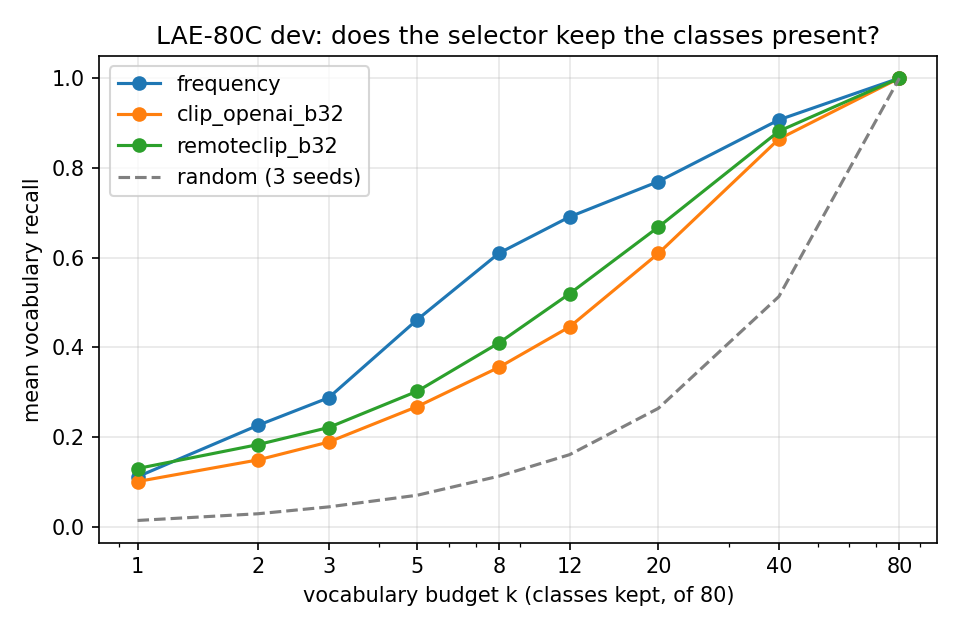

# Adaptive Vocabulary Selection for Robust Open-Vocabulary Object Detection in Aerial Imagery

**Project overview for review** · Team *Transmontane*: Amit Adhikari (23BCE2327), Himanshu Ray (23BCE2335), Saurav Kumar Gupta (23BCE2336), Avishek Chowdhury (23BCE2344)
**Status as of 25 Oct 2026:**
- Modules M0–M3 complete.
- The first experiment (E0) is complete.
- M4 (baselines) is in progress.

Repository: <https://github.com/Himanshu-RG/Vision-Aerial-Imagery>. The living project log is [`CONTEXT.md`](../CONTEXT.md); module reports are in [`reports/`](.).

---

## 1. Summary
Open-vocabulary detectors such as **Grounding DINO** find objects named in a text prompt. On aerial imagery, though, a prompt that lists every candidate class makes the detector confuse similar classes. We study whether **choosing a small, image-specific vocabulary before detection** helps a **frozen, pretrained** Grounding DINO on aerial images, and at what computational cost.

What we have established so far, all on the tuning (dev) split, with no test data used:
1. **There is large headroom.** If the detector is given only the classes actually present in each image (an *oracle*, not a method), AP50 rises from **0.015 to 0.140** (×9.6), and recall of ground-truth objects from **12% to 47%**.
2. **Content matters, not size.** A random vocabulary of the same small size is *no better* than all 80 classes. A useful selector must keep the classes that are present.
3. **A benchmark artifact we identified explains only ~11% of that gap.** The LAE-80C benchmark merges five datasets that each annotate a *disjoint* set of classes. We show this distorts standard evaluation, and we propose a source-aware evaluation.
4. **Off-the-shelf global CLIP selection keeps too few of the present classes.** At 3 classes it keeps 19–22%, and it misses small-object classes almost entirely. This motivates our core idea: combine **global (whole-image) and local (crop-level) evidence**.

---

## 2. Problem and motivation
- Aerial images contain **small, dense, visually similar objects**: 59% of the boxes in our benchmark are smaller than 32×32 pixels.
- Grounding DINO receives the class list as **one text prompt** (at most 256 tokens). With 80 overlapping aerial class names (`vehicle`, `small car`, `passenger car`, `van`, …), the detector spreads its confidence across confusable names.
- A recent study (Tsourveloudis, arXiv 2601.22164, Jan 2026) showed on the same benchmark that prompting with only the ground-truth classes gives a **15× higher F1**. It used ground truth, so it is not a usable method, and the study calls for "intelligent vocabulary filtering" as future work.
- **VocAda** (ICIP 2025) does test-time vocabulary pruning, but on natural images, with other detectors, using a 7B-parameter captioner (5–11 s per image, 17–31 GB GPU).

**Research question.** Can an **image-conditioned, deployable vocabulary selector** recover the oracle's headroom for a frozen Grounding DINO on aerial imagery, and do so faster than running the full vocabulary?

We **do not** claim vocabulary pruning itself is new (VocAda). The intended contribution is aerial-specific: global–local evidence, uncertainty-aware retention of plausible classes, an adaptive vocabulary budget, and a rigorous evaluation that accounts for the benchmark's label structure.

---

## 3. Related work and positioning (verified from primary sources)
| Work | Venue | What it does | Training? | Selects vocabulary per image? | Aerial? | Relation to us |
|---|---|---|---|---|---|---|
| Grounding DINO (Liu et al.) | ECCV 2024 | Language-guided open-set detector (DINO + BERT, deep vision–language fusion) | pretrained | no (user prompt) | no | **our frozen detector** |
| VocAda (Liu et al.) | ICIP 2025 | Caption → nouns → CLIP/LLM picks classes | no | **yes** (global caption only) | no (COCO, Objects365; Detic/VLDet/CoDet) | closest *method*; our baseline E ("VocAda-style") |
| Tsourveloudis | arXiv 2601.22164 (2026) | Zero-shot evaluation of 5 OV detectors on LAE-80C; oracle vocabulary gives 15× F1 | no | oracle only | **yes** | closest *study*; we replicate its direction with COCO metrics |
| LAE-DINO / LAE-1M (Pan et al.) | AAAI 2025 | RS open-vocabulary detector; "dynamic vocabulary construction" **during training** | yes | no (training-time) | yes | source of our benchmark (LAE-80C) |
| CastDet (Li et al.) | ECCV 2024 | Student–teacher OVD with RemoteCLIP teacher | yes | no | yes | supports RemoteCLIP for aerial semantics |
| OpenRSD (Huang et al.) | ICCV 2025 | Text/image-prompted RS detector, multi-stage training (470k images) | yes | no | yes | training-based alternative |
| Scene-adaptive & region-aware prompts (Zhao et al.) | CVPR 2024 | Learned scene/region prompts modify class embeddings | yes | no (modifies embeddings) | no | scene adaptation via training |
| TagCLIP (Lin et al.) | AAAI 2024 | Training-free *local-to-global* CLIP multi-label tagging | no | tags only (no detector) | no | **overlaps our global–local idea** and will be a baseline |

**Gap (citation sweep, 2026-10-20):** no work performs **deployable, inference-time vocabulary selection for a frozen open-vocabulary detector on aerial imagery**. **Novelty risk (honest):**
- Global CLIP selection: high. It is a baseline only.
- Global–local evidence: medium-high, because of TagCLIP.
- Uncertainty-aware retention: medium.
- Adaptive budget alone: high.

The defensible contribution is the aerial-specific selector *plus* a rigorous, artifact-aware evaluation.

---

## 4. System architecture

### 4.1 Pipeline

- **Selector variants (planned, in order):**
  - global CLIP / RemoteCLIP (M4);
  - **global + local crop evidence** (M5);
  - **uncertainty-aware retention** (M6);
  - **adaptive budget** (M7).
- **Hard rule:** the selector may only see image pixels, never the file name, source dataset, original image size, or annotations. We found image size alone reveals the source dataset, so this rule prevents a shortcut. A unit test enforces it.

### 4.2 Detector: Grounding DINO (Swin-T), frozen

| Property | Value (verified from the checkpoint/config) |
|---|---|
| Checkpoint | HF `IDEA-Research/grounding-dino-tiny`, commit `a2bb814d…`, sha256-locked |
| Parameters | **172.3 M** in total: BERT 108.9 M, Swin-T 27.6 M (depths 2-2-6-2), feature enhancer 21.9 M, decoder 11.1 M, heads/projections 2.9 M |
| Hidden size / queries / text limit | 256 / **900** / **256 tokens** |
| Feature levels / deformable points | 4 / 4 |
| Pretraining (Swin-T) | Objects365, GoldG, Cap4M (natural images; no aerial benchmark) |
| Our inference protocol | Official COCO-evaluation protocol of the Grounding DINO repo: caption `"a . b . c ."`, positive-map **mean** token scoring, resize to 800 short side / 1333 max, fp32. We keep the **top-900** (box, class) pairs because some images have up to 668 objects |

### 4.3 Selector encoders (Module 4)
| Model | Architecture | Parameters | Pretraining | Use |
|---|---|---|---|---|
| OpenAI CLIP ViT-B/32 | ViT-B/32 image encoder (12 layers, width 768, 224 px) + 12-layer text transformer; 512-d joint space | **151.3 M** (image 87.8 M, text 63.4 M) | 400 M web image–text pairs | natural-image baseline |
| RemoteCLIP ViT-B/32 | same architecture, remote-sensing fine-tuned | 151.3 M | remote-sensing image–caption data, which per its paper includes captions generated from detection datasets such as DOTA/DIOR (training labels; LAE-80C uses their *validation* images; exact overlap to be re-verified) | aerial-domain selector |

Class relevance = cosine similarity between the image embedding and the averaged embedding of three fixed prompt templates per class. These are similarities, not calibrated probabilities.

---

## 5. Data and evaluation protocol
**Benchmark: LAE-80C** (validation benchmark of LAE-1M, MIT license, pinned commit `60ce78a`): **3,592 images, 86,558 boxes, 80 classes**, horizontal boxes.

| Source | Images | Classes annotated | Boxes / image | Small boxes |
|---|---|---|---|---|
| FAIR1M (FAIR-18C) | 2,130 | 18 (vehicles, ships, …) | 18.0 | 91% |
| xView (Xview-34C) | 758 | 34 | 59.9 | 34% |
| DIOR (DIOR-18C) | 536 | 18 | 4.0 | 30% |
| DOTA (DOTA-6C) | 137 | 6 | 3.8 | 17% |
| Power plants (PP-4C) | 31 | 4 | 4.8 | 3% |

**Our main dataset finding:** the five sources annotate **disjoint** class sets. A car is "Small Car" in FAIR, "Passenger Car" in xView and "vehicle" in DIOR, and each image is labelled only with its own source's names. Under standard COCO evaluation, a correct "vehicle" box on a FAIR image counts as a false positive.

| Protocol element | Choice (frozen before any detector run) |
|---|---|
| Split | Our own **dev 730 / test 2,862** (iterative multi-label stratification, seed 2026). All tuning happens on dev; test is untouched until the final evaluation |
| Cleaning | 972 edge-cut boxes clipped to the image; 19 exact duplicates removed; 23 tiny boxes flagged. Every change is logged |
| Class names | Lower-case, glued names split (`groundtrackfield` → "ground track field"), no synonyms. The full prompt is 249/256 tokens |
| Evaluation | **Source-aware COCO** (primary: per image, only classes annotated by its source are scored) **and standard COCO** (for comparability) |
| Metrics | AP50 and AP at maxDets 900 (headline) and 100; AR; per-size and per-class AP; vocabulary recall; latency; peak GPU memory |
| Statistics | Paired image-level bootstrap (1,000 resamples) for every comparison |

---

## 6. What has been accomplished
| Module | Content | Status |
|---|---|---|
| M0 | Literature audit (13 works, primary sources), gap, hypotheses H0–H7, novelty-risk assessment | ✅ |
| M1 | Two-machine setup (dev laptop + RTX 5060 8 GB), exact version pins, checksummed model weights, environment audits | ✅ |
| M2 | Dataset validation, manifest, frozen split, naming policy, evaluation protocol | ✅ |
| M3 | Grounding DINO pipeline, two evaluators, bootstrap statistics; **known-answer tests** (feeding ground truth back gives AP = 1.0, etc.). 40 automated tests at M3; 46 now | ✅ |
| E0 | Headroom experiment on 200 dev images (RTX 5060) | ✅ |
| M4 | Baselines: selection quality measured; detection with selected vocabularies is next | 🟡 |

**Reproducibility:**
- Every run is identified by a hash of its configuration and records its commit, machine, GPU state and checkpoint hashes.
- Every table is generated from saved results by a script, never typed by hand.
- Failed images are counted, never dropped.

---

## 7. Results so far (dev split only)

### 7.1 E0 — how much can vocabulary selection help? (200 dev images, RTX 5060)
| Vocabulary given to the detector | Classes | AP50 (standard) | AP50 (source-aware) | Recall of GT objects (AR@900) | Latency / image |
|---|---|---|---|---|---|
| Full vocabulary | 80 | 0.015 | 0.028 | 0.124 | 418 ms |
| *Oracle:* the image's source class list | ~21 | 0.031 | 0.031 | 0.293 | 344 ms |
| *Oracle:* classes present in the image | ~2 | **0.140** | **0.140** | **0.467** | 333 ms |
| *Control:* random classes, same size | ~2 | 0.007 | 0.008 | 0.015 | 332 ms |

Paired bootstrap, oracle minus full: **+0.126** [0.119, 0.187] standard; **+0.112** [0.102, 0.166] source-aware.

**Interpretation:**
- The headroom is large and statistically clear.
- About 89% of it remains under source-aware evaluation, so it is genuinely about per-image class relevance and not a benchmark artifact.
- Giving the detector the right *dataset's* class list barely helps; selection must be per image.
- Small vocabularies are about **20% faster**, so a selector must cost under ~85 ms per image for a net speed-up.
- **Ceiling:** even with the oracle, AP50 is only 0.14, and 18 of 75 classes stay near zero (fine-grained vehicles, "working/unworking chimney", …). No vocabulary selector can fix those.

### 7.2 M4 step 1 — do simple selectors keep the classes present? (730 dev images, no detector)

| Selector | keeps present classes at k=3 | k=8 | k=20 |
|---|---|---|---|
| Fixed frequency prior (fit on dev, so optimistic) | 0.288 | 0.610 | 0.770 |
| OpenAI CLIP ViT-B/32 (global) | 0.189 | 0.356 | 0.609 |
| RemoteCLIP ViT-B/32 (global) | 0.221 | 0.410 | 0.668 |
| Random (3 seeds) | 0.045 | 0.113 | 0.264 |

**Interpretation:**
- **RemoteCLIP beats CLIP at every budget below 80** (paired bootstrap CIs exclude 0 for k = 1, 2, 3, 5, 8).
- But both are far from the oracle and below a fixed frequency prior.
- At k = 5, global CLIP keeps only **4% (CLIP) / 16% (RemoteCLIP)** of the classes whose objects are small, vs 35–44% for others. **A single whole-image embedding does not see small objects.** That is the motivation for local, crop-level evidence (M5).

Full tables: [`generated/E0_tables.md`](generated/E0_tables.md), [`generated/M4_selection_tables.md`](generated/M4_selection_tables.md).

---

## 8. Comparison plan (experiment matrix)
| ID | Method | Deployable | Status |
|---|---|---|---|
| E1 | Full vocabulary | ✓ | done (E0) |
| E2 | Fixed reduced vocabulary (frequency prior) | ✓ | selection ✓, detection next |
| E3 | Random vocabulary (3 seeds) | ✓ (control) | selection ✓, detection next |
| E4 | Global CLIP / RemoteCLIP top-k | ✓ | selection ✓, detection next |
| E5 | Caption-based ("VocAda-style", small captioner) | ✓ | planned |
| E6 | **Global + local (multi-scale crops) selection** | ✓ | planned (M5) |
| E7 | **+ uncertainty-aware retention** (calibrated on dev for a target vocabulary recall) | ✓ | planned (M6, gated) |
| E8 | **+ adaptive vocabulary budget** | ✓ | planned (M7, gated) |
| — | Oracle diagnostics (GT classes, source class list) | ✗ | done (E0); used as upper bounds |

Each method is compared at **matched average vocabulary sizes**, with accuracy–latency curves, recall broken down by object size and class rarity, both evaluation protocols, and paired bootstrap confidence intervals.

## 9. Next steps
1. **M4 step 2:** detection with the M4 selectors at k ∈ {3, 8, 20, 40} on the RTX 5060. This tests H2: does any deployable selector beat the full vocabulary? Then GPU timing of the selectors.
2. **M5:** global + local selection (multi-scale crops, evidence aggregation), with a TagCLIP-style baseline. The key test is recovering small-object classes.
3. **M6/M7** (only if M4/M5 show a selector beating the full vocabulary): uncertainty-aware retention and adaptive budget.
4. **M10–M11:** failure analysis (tiny objects, dense scenes, similar classes, rare classes) and per-source generalization. One-time final evaluation on the held-out test split.
5. **M12–M14:** latency profiling, reproducibility package, paper draft.

## 10. Risks and honest assessment
- **Detector ceiling:** GDINO-T reaches only 0.14 AP50 even with a perfect vocabulary, so absolute numbers will be low. Higher input resolution or tiling may be needed, applied identically to all methods.
- **H2 may fail for simple selectors.** Missing a present class is costly (E0), and global CLIP keeps few at small budgets. A negative result would still be informative and will be reported.
- **Statistics:** percentile bootstrap intervals for AP are slightly shifted; diagnostics have been added. Small sample (200 images) for detection experiments so far.
- **Publication realism:** with a frozen GDINO-T and one benchmark, a main-track CVPR/ICCV/ECCV paper is unlikely unless effects are large and consistent. A strong workshop paper (e.g. CVPR EarthVision) or IGARSS / IEEE GRSL / JSTARS is realistic. No acceptance is assumed.

## References (primary sources)
1. S. Liu et al., *Grounding DINO: Marrying DINO with Grounded Pre-Training for Open-Set Object Detection*, ECCV 2024 (arXiv 2303.05499).
2. M. Liu, T. L. Hayes, M. Mancini, E. Ricci, R. Volpi, G. Csurka, *Test-Time Vocabulary Adaptation for Language-Driven Object Detection*, ICIP 2025 (arXiv 2506.00333).
3. C. Tsourveloudis, *Do Open-Vocabulary Detectors Transfer to Aerial Imagery? A Comparative Evaluation*, arXiv 2601.22164, 2026.
4. J. Pan et al., *Locate Anything on Earth: Advancing Open-Vocabulary Object Detection for Remote Sensing Community*, AAAI 2025 (arXiv 2408.09110).
5. Y. Li et al., *Toward Open Vocabulary Aerial Object Detection with CLIP-Activated Student-Teacher Learning*, ECCV 2024 (arXiv 2311.11646).
6. Z. Huang et al., *OpenRSD: Towards Open-prompts for Object Detection in Remote Sensing Images*, ICCV 2025 (arXiv 2503.06146).
7. X. Zhao et al., *Scene-adaptive and Region-aware Multi-modal Prompt for Open Vocabulary Object Detection*, CVPR 2024.
8. Y. Lin et al., *TagCLIP: A Local-to-Global Framework to Enhance Open-Vocabulary Multi-Label Classification of CLIP Without Training*, AAAI 2024 (arXiv 2312.12828).
9. A. Radford et al., *Learning Transferable Visual Models From Natural Language Supervision* (CLIP), ICML 2021.
10. F. Liu et al., *RemoteCLIP: A Vision Language Foundation Model for Remote Sensing*, IEEE TGRS 2024 (weights: HF `chendelong/RemoteCLIP`).
