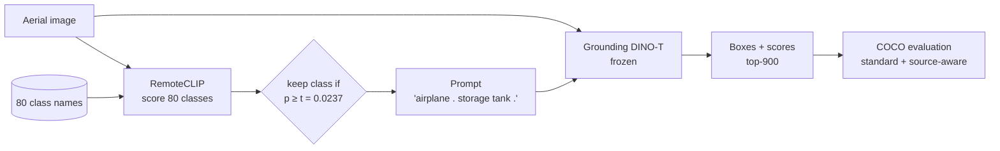
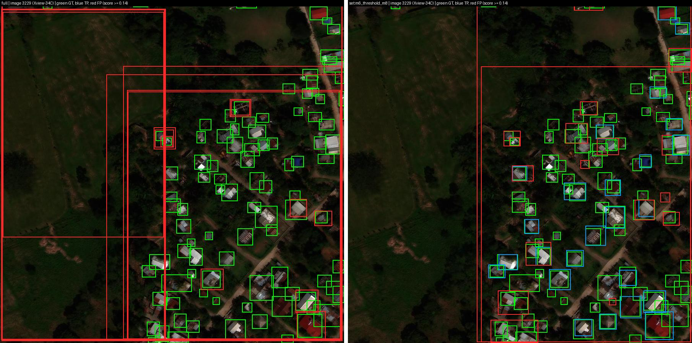
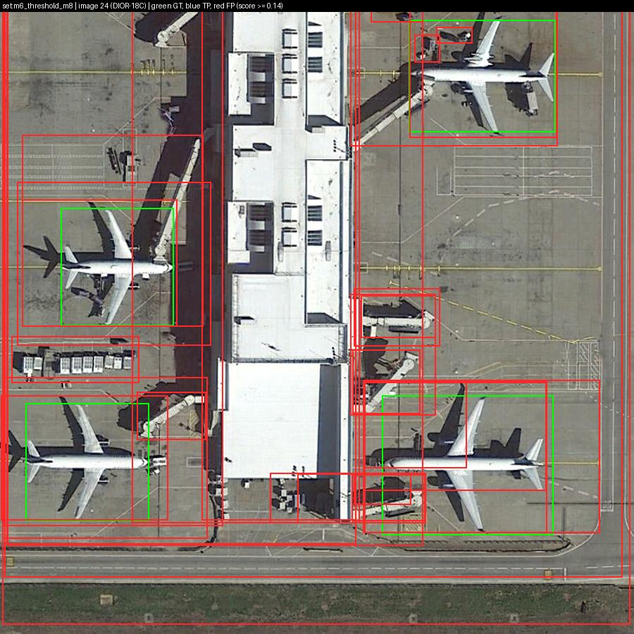
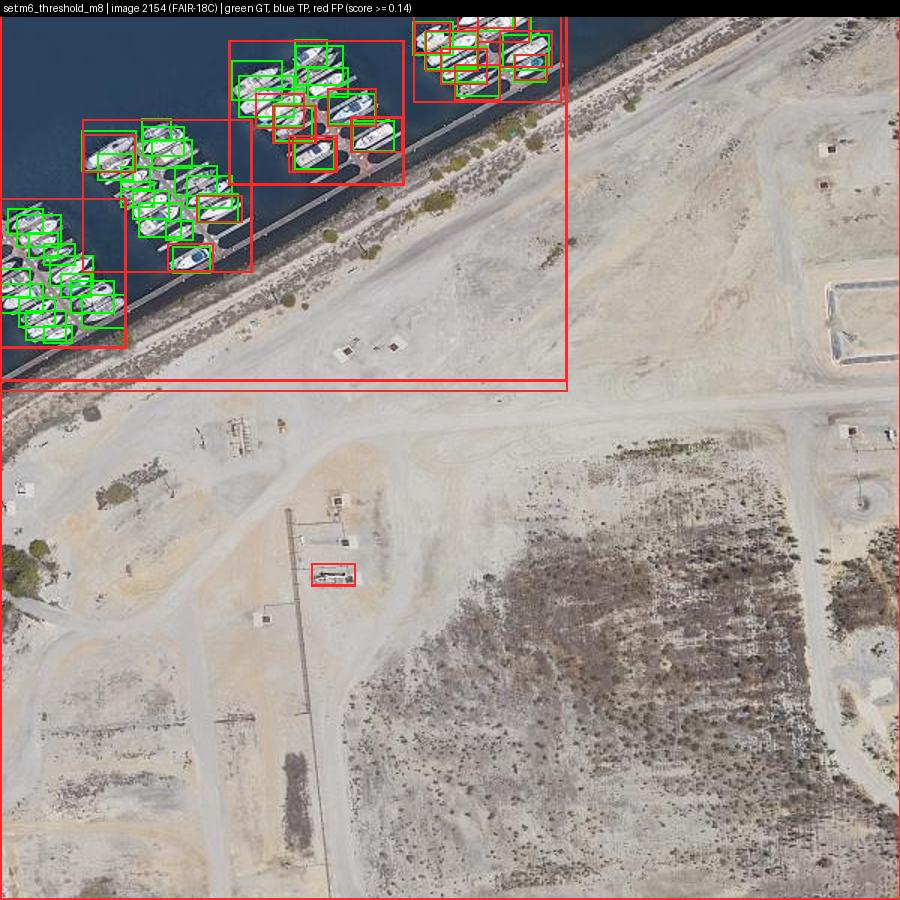
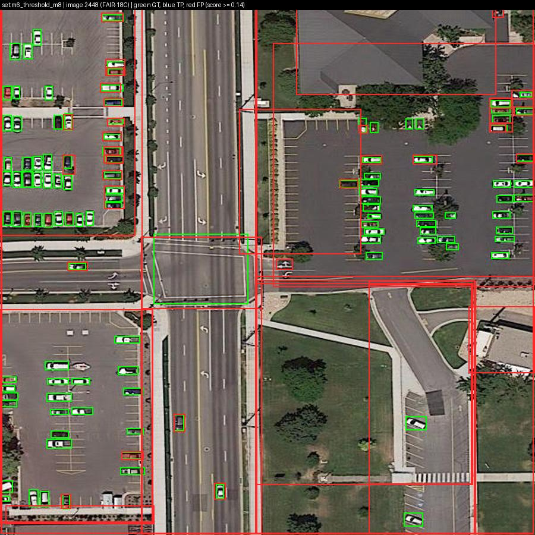
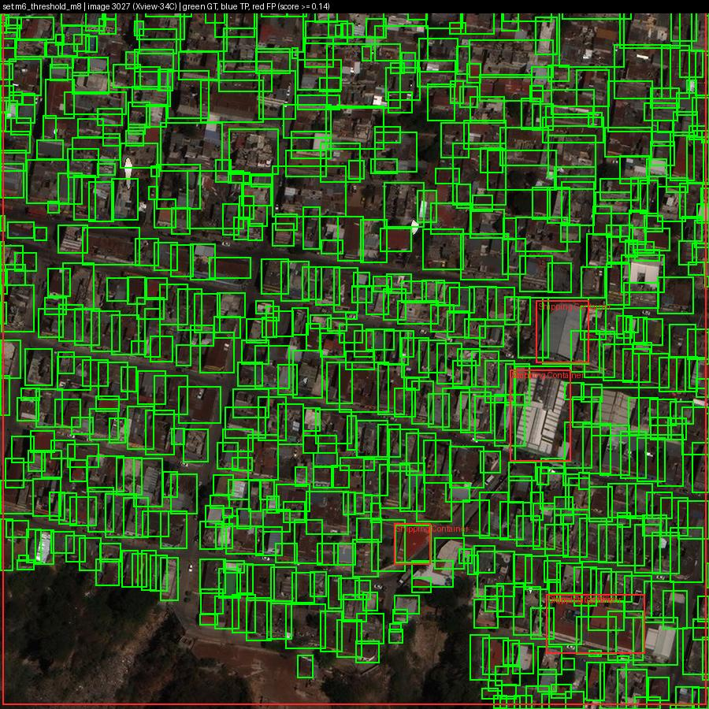
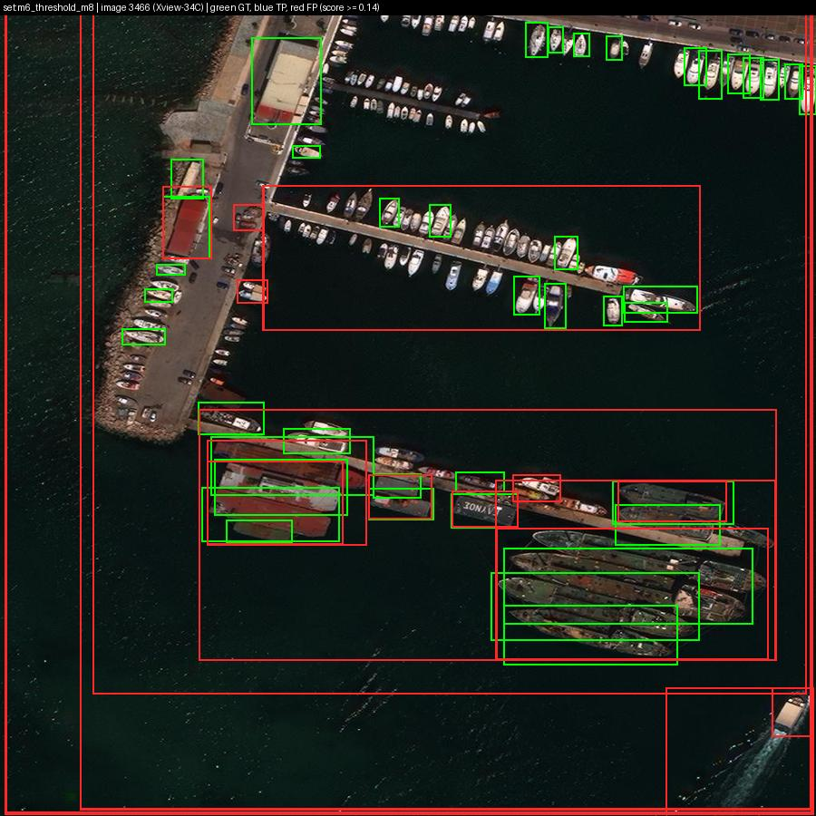

# Adaptive Vocabulary Selection for Robust Open-Vocabulary Object Detection in Aerial Imagery

**Team Transmontane:** Amit Adhikari (23BCE2327), Himanshu Ray (23BCE2335), Saurav Kumar Gupta (23BCE2336), Avishek Chowdhury (23BCE2344)
**Repository:** <https://github.com/Himanshu-RG/Vision-Aerial-Imagery> · **Status:** 2 Nov 2026. Method development finished on the tuning (dev) split. The **one-time held-out test evaluation is done** (2,862 images; everything fixed in advance, D47). Remaining: latency profiling, reproducibility package, paper.

---

## 1. Brief description
- **Problem.** Open-vocabulary detectors such as Grounding DINO find the objects named in a text prompt. On aerial images, a prompt listing all 80 candidate classes (`vehicle`, `small car`, `passenger car`, `van`, …) makes the detector spread its confidence across look-alike names, and accuracy collapses.
- **Idea.** Before detection, look at the image and choose a **small, image-specific class list**. Then prompt the **frozen, pretrained** detector with that list only. No training, no fine-tuning.
- **Question.** Can a deployable selector (one that sees only pixels) recover the gain that a perfect class list gives, and at what cost?
- **Answer.** Yes, partly.
  - On the held-out test split, our adaptive selector improves AP50 **×5.3** (standard scoring) and **×2.7** (source-aware scoring) over the full 80-class prompt, robustly under both.
  - It also transfers, untuned, to a new dataset (NWPU VHR-10: 0.088 → 0.129).
  - It does not help on fine-grained datasets its encoder never saw (FAIR1M, xView).

---

## 2. Tech stack
| Layer | Tools |
|---|---|
| Language / DL | Python 3.10–3.11, PyTorch 2.7.1 (CPU wheel on the dev laptop, cu128 on the RTX 5060), torchvision 0.22.1 |
| Models | Hugging Face `transformers` 4.57.3 (Grounding DINO), `open_clip_torch` 3.3.0 (CLIP, RemoteCLIP), `huggingface_hub`, `safetensors` |
| Evaluation | `pycocotools` 2.0.11, plus our own source-aware COCO evaluator, paired bootstrap and sign test |
| Data / plots | NumPy 2.2.6, pandas 2.3.3, Pillow, matplotlib |
| Config / tests | YAML + pydantic configs, pytest (**67 tests**), JSONL run logs |
| Hardware | Dev laptop (CPU only: selection, analysis, reports); RTX 5060 8 GB laptop (all detection and timing) |
| Workflow | Git + GitHub sync between the two machines; exact version pins and per-machine lock files; sha256-locked model weights |

---

## 3. Models used
| Model | Role | Size | Pretraining |
|---|---|---|---|
| **Grounding DINO-T** (Swin-T + BERT-base), HF `IDEA-Research/grounding-dino-tiny` | the detector, **frozen** | 172.3 M params | Objects365, GoldG, Cap4M (natural images) |
| **RemoteCLIP ViT-B/32** | **our selector's encoder** | 151.3 M | remote-sensing image–caption data (includes DIOR, DOTA; not FAIR1M or xView) |
| OpenAI CLIP ViT-B/32 | natural-image selector (control) | 151.3 M | 400 M web image–text pairs |
| Florence-2-base | captioner for the VocAda-style baseline only | ~0.23 B | general vision–language |

---

## 4. Pipeline

1. **Score.** Encode the image with RemoteCLIP. Compare it with each class name (3 fixed templates, e.g. "a satellite image of a {}"). Softmax gives a probability per class.
2. **Select (adaptive).** Keep every class above a threshold `t`, calibrated once on other dev images to give about 8 classes on average. Clear images get 1–3 classes; ambiguous ones get more.
3. **Prompt.** Join the kept names in Grounding DINO's official format `"a . b . c ."`.
4. **Detect.** The frozen detector returns its top 900 (box, class) pairs.
5. **Evaluate.** COCO AP50 under two protocols (below), with three statistical checks.
- **Hard rule (D16):** the selector sees **only pixels**. It never sees the file name, image size or source dataset, because image size alone reveals the source. A unit test enforces this.
- **Cost:** about 8 ms per image on the GPU, against 350–550 ms for the detector.

---

## 5. Present work vs gaps found
| Work | What it does | Gap relative to our question |
|---|---|---|
| Grounding DINO (ECCV 2024) | Open-set detector driven by a text prompt | The user supplies the prompt; nothing chooses it per image |
| VocAda (ICIP 2025) | Caption → nouns → pick classes at test time | Natural images only; other detectors (not Grounding DINO); 7B captioner, 5–11 s/image, 17–31 GB GPU |
| Tsourveloudis (arXiv 2601.22164, 2026) | Evaluates 5 OV detectors on LAE-80C; perfect class list gives 15× F1 | Uses ground truth (**not deployable**); F1 only, no COCO AP; lists "intelligent vocabulary filtering" as future work |
| LAE-DINO (AAAI 2025) | Aerial OV detector, vocabulary built during **training** | Requires training; no per-image selection at inference |
| CastDet (ECCV 2024), OpenRSD (ICCV 2025), Zhao et al. (CVPR 2024) | Training-based aerial OVD or learned prompts | All need training; none prunes the vocabulary at inference |
| TagCLIP (AAAI 2024) | Training-free local-to-global CLIP tagging | Natural images; tags only, no detector |

**Gaps we identified:**
- No work does **deployable, inference-time vocabulary selection for a frozen OV detector on aerial imagery**.
- The benchmark has a hidden problem: LAE-80C merges 5 datasets that label **disjoint** class sets. A correct "vehicle" box on a FAIR1M image (labelled "Small Car") counts as a false positive. Standard COCO scoring does not account for this.
- Prior aerial OVD studies report no image-level confidence intervals and no robustness checks.

---

## 6. Our novelty
We **do not** claim vocabulary pruning itself is new (VocAda). Our contributions:
1. **First deployable per-image vocabulary selector for a frozen Grounding DINO on aerial imagery.** It is training-free and costs about 8 ms per image.
2. **Adaptive vocabulary size.** A calibrated probability threshold, not a fixed top-k. This turned out to be what makes the method work: fixed top-k with the same encoder gives no gain on NWPU.
3. **Source-aware evaluation** for merged benchmarks. Per image, only the classes its source dataset annotates are scored. We show that standard scoring alone accounts for about 11% of the headroom gap.
4. **Rigorous protocol.**
   - Every claim must pass three checks (D26): percentile bootstrap CI, basic bootstrap CI and a per-class sign test.
   - Every decision was fixed before results.
   - A held-out test split is used exactly once.
   - Negative results are reported, not hidden.
5. **Honest limits.**
   - We measured *where* it works: datasets resembling RemoteCLIP's training data.
   - We measured where it does not: fine-grained, unfamiliar label spaces.
   - We showed the small-object weakness lies in the detector, not the vocabulary.

---

## 7. Before and after comparison
**(a) Final result: held-out test split, 2,862 images, run once (AP50 at 900 detections)**
| Vocabulary given to the detector | Avg. classes | AP50 standard | AP50 source-aware | Ours better? |
|---|---|---|---|---|
| **Before:** all 80 classes | 80 | 0.0053 | 0.0157 | yes, robust (both) |
| Random classes (control) | 2.3 | 0.0023 | 0.0038 | yes, robust |
| Frequency prior top-8 | 8 | 0.0028 | 0.0056 | yes, robust |
| OpenAI CLIP top-20 | 20 | 0.0081 | 0.0238 | yes (robust under standard) |
| RemoteCLIP top-8 (fixed size) | 8 | 0.0170 | 0.0347 | **yes, robust (both)** |
| Adaptive top-p, ~20 classes | 20 | 0.0276 | 0.0406 | tie |
| **After: ours (adaptive threshold, frozen)** | 8 | **0.0280 (×5.3)** | **0.0418 (×2.7)** | – |
| *Oracle: classes really present (upper bound)* | 2.3 | 0.1072 | 0.1072 | – |

- Seen datasets (DIOR + DOTA): 0.035 → 0.120 source-aware.
- Unseen datasets (FAIR1M, xView, PP): 0.008 → 0.009.
- F1 at the dev-fixed thresholds: 0.014 → 0.036 (standard).
- Full analysis: [FINAL_TEST.md](FINAL_TEST.md).

**(b) Dev split, 200 images, AP50 at 900 detections (RTX 5060)**
| Vocabulary given to the detector | Avg. classes | AP50 standard | AP50 source-aware | Robust vs full? |
|---|---|---|---|---|
| **Before:** all 80 classes | 80 | 0.015 | 0.028 | – |
| Random classes (control) | ~2 | 0.007 | 0.008 | no better than full |
| Frequency prior (top-3 to top-40) | 3–40 | – | 0.004–0.017 | worse |
| VocAda-style caption top-8 | 8 | 0.022 | 0.034 | worse than RemoteCLIP top-8 |
| OpenAI CLIP top-20 | 20 | – | 0.049 | yes (source-aware only) |
| RemoteCLIP top-8 (fixed size) | 8 | 0.035 | 0.058 | yes (source-aware only) |
| Global + local crops, top-8 | 8 | – | 0.053 | no |
| **After: ours (adaptive threshold)** | ~8 | **0.055 (×3.8)** | **0.071 (×2.5)** | **yes, both protocols** |
| *Oracle: classes really present (upper bound)* | ~2 | 0.140 | 0.140 | – |

**(c) Where it works: per source group (dev, source-aware AP50)**
| | DIOR + DOTA (RemoteCLIP saw these) | FAIR1M + xView + PP (unseen) |
|---|---|---|
| All 80 classes | 0.069 | 0.011 |
| **Ours** | **0.223** | 0.007 (no gain) |
| Oracle | 0.262 | 0.090 |

**(d) New dataset, applied frozen with no retuning: NWPU VHR-10 (614 images)**
| | AP50 | F1 at score 0.25 |
|---|---|---|
| All 80 classes | 0.088 | 0.08 |
| RemoteCLIP top-8 (fixed size) | 0.093 (not significant) | – |
| OpenAI CLIP top-20 | 0.100 | – |
| **Ours** | **0.129 (+0.041, robust)** | **0.18** |
| Oracle | 0.208 | – |

**(e) Speed (indicative; GPU was not idle):** on test, the detector takes 442 ms with all 80 classes vs 347 ms with ours. Adding the ~8 ms selector, that is about **20% faster** end to end. Idle-GPU timing comes in M12.

---

## 8. Why ours worked
- **The headroom is about content, not size.** A random list of the same size does no better than all 80 classes. A selector has to keep the classes actually present, and RemoteCLIP keeps more of them than OpenAI CLIP at every budget.
- **It removes confusers.** With the full prompt, 77% of confident false detections belong to classes never labelled in that dataset. Our selection cuts confident false detections by 76%.
- **Adaptive size fits each image.** When RemoteCLIP is confident (a stadium, an airport), the prompt shrinks to 1–3 clean classes. When it is unsure, the prompt grows. A fixed top-k either drops present classes or keeps confusers. The gain shows mostly on large objects (AP50 0.088 → 0.128).
- **Aerial-trained encoder.** RemoteCLIP understands overhead views. That is also why the gain stays on DIOR/DOTA-like data and NWPU, and vanishes on FAIR1M/xView.
- **Why it doesn't do better.** Two limits bound it:
  - **The detector.** Even the perfect list gives only 0.14 AP50, and 18 classes stay near zero. Tiling did not help small objects.
  - **Cross-source near-synonyms.** 59% of the classes our selector keeps belong to another dataset's label set (e.g. "Ferry" vs "Passenger Ship"). Our synonym-aware fix (E9) gave no gain.

---

## 9. Demo / examples from the dataset
Images chosen by fixed rules (D40), not hand-picked. Green = ground truth, blue = correct detection, red = false detection (score ≥ 0.14).

**Selection gain** (xView image 3229, village buildings). Left: all 80 classes, with huge false boxes and almost nothing found. Right: ours, with many buildings correctly found.

| Example | What it shows |
|---|---|
|  | **Success** (DIOR 24): highest share of objects found |
|  | **Similar classes** (FAIR 2154, marina): right objects, wrong boat name |
|  | **Tiny objects** (FAIR 2448, 114 objects): the detector misses them even when the class is kept |
|  | **Dense scene** (xView 3027, 650 objects): selection hurts above ~20 objects |
|  | **Rare-class miss** (xView 3466, harbour): rare classes dropped from the vocabulary |

**What the selector actually chose** (from the frozen dev mask `outputs/selection/dev/m6_threshold_m8.npz`, instead of all 80 classes):
| Image | Classes kept | Selected vocabulary |
|---|---|---|
| DIOR 24 (airport, "success") | 6 | airplane, airport, vehicle, Small Aircraft, Passenger Car, Engineering Vehicle |
| xView 3229 (village, "selection gain") | 8 | Bus, Motorboat, Small Car, Van, Locomotive, Front loader/Bulldozer, Shed, Building |
| FAIR 2154 (marina, "similar classes") | 6 | harbor, Fishing Boat, Motorboat, Tugboat, Sailboat, Ferry |
| FAIR 2448 (road junction, "tiny objects") | 4 | overpass, roundabout, Bus, Intersection |

- The lists are relevant to each scene, but they mix names from different source datasets. "vehicle" (DIOR) sits next to "Passenger Car" (xView); "Ferry" (xView) appears on a FAIR image. This is the cross-source synonym failure from §8.
- Across the 730 dev images, list sizes range from 1 to 17 classes, with an average of 7.9.

---

## 10. Project journey and decisions
### Timeline
| Date (2026) | Phase | Outcome |
|---|---|---|
| 20 Oct | **M0** literature audit (13 papers) · **M1** two-machine setup | Gap found; hypotheses H0–H7; venue set realistically (workshop / IGARSS / GRSL) |
| 21–24 Oct | **M2** dataset | LAE-80C validated and cleaned; disjoint label spaces discovered; split frozen (dev 730 / test 2,862) |
| 24–25 Oct | **M3** pipeline + **E0** headroom | Perfect list gives AP50 0.015 → 0.140 (×9.6): large headroom; random list gives none |
| 25 Oct | **M4** simple selectors | RemoteCLIP top-8 robustly beats full (source-aware); selection misses small objects |
| 26–30 Oct | **M5** global + local crops | Better selection of small-object classes, **no detection gain**; crops cost 83 ms → dropped (negative result) |
| 30–31 Oct | **M6/M7** retention + adaptive budget | Retention: no gain. **Adaptive threshold: best method, frozen (D34)** |
| 31 Oct | **M8/M9** registry, F1, tiling test | Tiling doesn't fix small objects; F1 thresholds fixed |
| 31 Oct | **E5** VocAda-style and TagCLIP-style baselines | Neither beats ours; captioning is 14× slower |
| 1 Nov | **M10** failure analysis · **E9** synonym fix | Main failure: cross-source synonyms; fix gives no gain → headline unchanged |
| 1–2 Nov | **M11** generalization | Works on seen-type data + NWPU (+0.041), not on FAIR1M/xView |
| 2 Nov | **Final test pre-registered (D47), then run once** | Confirmed under both protocols: ×5.3 / ×2.7 vs full; beats fixed top-8; seen/unseen pattern holds (D48) |
| Next | **M12–M14** | Idle-GPU latency, reproducibility package, paper |

### Hypotheses: outcome
| | Hypothesis | Result |
|---|---|---|
| H0 | 80 class names overflow the 256-token prompt | **False**: 249 tokens, a single prompt |
| H1 | Perfect class list beats full | **Supported**, robust (+0.126) |
| H2 | A deployable selector beats full | **Supported** (source-aware, k = 8–20) |
| H3 | Local crops help small-object classes | Selection yes, **detection no** |
| H4 | Uncertainty-aware retention helps | **Not supported** |
| H5 | Adaptive budget beats fixed-k | Dev: supported vs full, partly vs top-k. **Test: robustly beats top-8** |
| H6 | Faster than full end to end | Provisionally yes (−19%); M12 confirms |
| H7 | Label-space mismatch explains the gap | Holds, but only ~11% of it |

### All decisions (D1–D47)
| ID | Decision |
|---|---|
| **Setup** | |
| D1 | Dataset: LAE-80C (80 classes, MIT license, used by the closest prior study) |
| D2, D18 | Split once into dev 20% / test 80% by multi-label stratification, seed 2026 (730 / 2,862); ID lists committed before any detection |
| D3, D19 | Generalization: per-source breakdown + external set (class mapping deferred to M11) |
| D4, D11 | Detector: HF Grounding DINO-T, frozen; all checkpoints pinned by commit + sha256 |
| D7 | Selector encoders: OpenAI CLIP vs RemoteCLIP ViT-B/32 (RemoteCLIP exposure to DOTA/DIOR noted) |
| D8 | VocAda-style baseline uses small Florence-2 (LLaVA-7B doesn't fit 8 GB); labelled "-style", not a reproduction |
| D9, D12, D13 | Timing only on the RTX 5060 (the reference environment); dev laptop is CPU-only; both machines on identical pins |
| **Prompt and detector protocol** | |
| D5 → D20 | Class score = mean of token sigmoids over the class name (official Grounding DINO protocol); caption `"a . b . c ."` |
| D6 → D10 | Chunk the prompt only if > 256 tokens; the full list fits (H0 false) |
| D14 | Naming "light": lower-case, split 7 glued DIOR names (`groundtrackfield` → "ground track field"), no synonyms |
| D21 | Keep top-900 detections; headline metric AP50@900 (some images have 668 objects) |
| D22 | Detection sample: 200 stratified dev images; latency = preprocess + forward + postprocess |
| **Evaluation** | |
| D15 | Two protocols: source-aware (primary) and standard COCO; oracles are diagnostics, never methods; no novel-class claims |
| D16 | Selector sees pixels only (enforced by test) |
| D17 | Cleaning: clip 972 edge boxes, drop 19 duplicates, flag 23 tiny boxes; all logged |
| D26 | "Robust" = percentile CI + basic CI + per-class sign test all agree |
| D27 | Report class-wise ranking mAP too: image-level recall proved misleading |
| D35 | F1 thresholds fixed from dev: 0.14 standard / 0.12 source-aware (+ 0.25 / 0.35 for comparison) |
| **Method development** | |
| D23 | CLIP selector: 3 fixed templates, cosine similarity, stable top-k ties |
| D24 | Selector scores computed on the laptop and committed, so both machines use identical vocabularies |
| D25 | Frequency prior is fit on dev, so its dev numbers are optimistic (flagged) |
| D28, D29 | Global + local variant picked by a pre-declared rule (RemoteCLIP α = 0.25, mean over 13 crops) |
| D30 | After M5's negative result: the global RemoteCLIP selector stays the base |
| D31, D36, D37 | One tiling diagnostic only; result: small objects are a detector limit, so no more detector-side work |
| D32, D33 | Calibration protocol: tune each rule's one parameter on 530 other dev images to a target size (3 / 8 / 20), never to a score |
| **D34** | **Headline frozen: RemoteCLIP probability ≥ t = 0.0237 (~8 classes)**; secondaries: threshold m20, top-p m20, fixed top-8 |
| D38, D39 | E5 baseline definitions; no post-hoc caption + RemoteCLIP union |
| D40 | Failure-analysis categories and example-selection rules fixed before the run |
| D41–D43 | Synonym-aware selector (E9) tested by a pre-declared replacement rule; it failed, so D34 stays |
| **Generalization and final test** | |
| D44 | RemoteCLIP saw DIOR, DOTA (and VisDrone, so VisDrone was rejected as "unseen"); report seen vs unseen groups on test |
| D45, D45a | External set NWPU VHR-10 (614 images, 9 classes; ship dropped); methods applied frozen; 33 colour-infrared images reported separately |
| D46 | Claim wording: gain transfers to data resembling the encoder's training data, not to fine-grained unfamiliar label spaces |
| **D47** | **Final test pre-registered:** re-use dev thresholds (no recalibration), 9 conditions, primary claim = ours vs full under both protocols |
| **D48** | **Final test result recorded as declared:** primary claim confirmed; no method changed afterwards |

### Limitations
- Absolute AP stays low: the frozen GDINO-T reaches only 0.14 AP50 even with a perfect class list.
- Small and fine-grained objects are a detector problem; fixing them needs aerial adaptation of the detector, which is out of scope.
- No gain on FAIR1M/xView-type data.
- Possible overlap between NWPU and DIOR images is unchecked.
- Latency was measured on a busy GPU.
- The headline method was chosen among 9 options on dev. The test run confirmed it, but with a smaller gain (29% vs 38% of the oracle headroom).
- On pooled box-level F1, a fixed list of the most frequent (dense) classes scores higher than ours, while its AP is the lowest.
